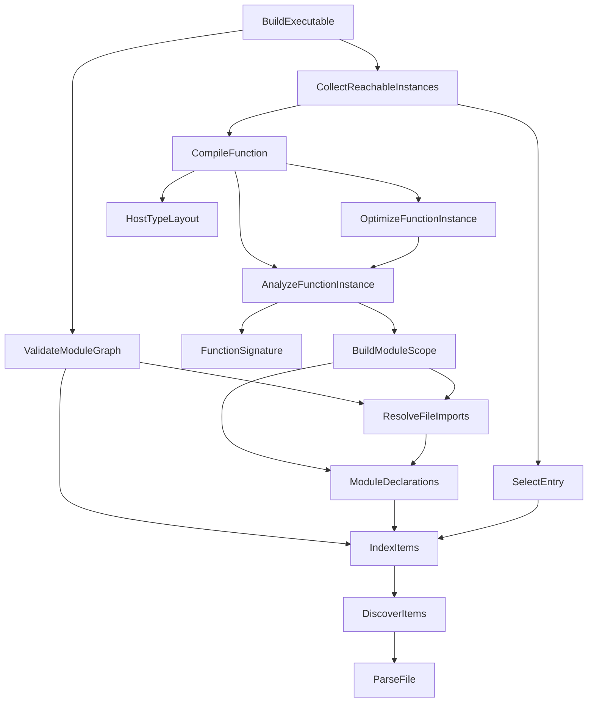

# Query Flow

[Architecture](ARCHITECTURE.md) owns stage boundaries and representation
contracts. This document follows demand, recomputation, and result lifetimes.
Use the [compiler guide](docs/COMPILER.md) for commands.

## Compilation Demand

Arrows follow requests from a result toward its dependencies. Repeated source,
scope, type-fact, and layout reads are omitted.

1. The CLI discovers the entry directory and registers it with embedded std
   sources. `SourceRegistry` supplies file IDs; enumeration positions are not
   identities. The root `std/` directory is reserved for compiler-owned sources.
2. `ParseFile`, `DiscoverItems`, and `IndexItems` identify declarations and each
   file's synthetic entry. Module queries combine current member files, validate
   duplicates, and resolve file-scoped imports and reexports. Effective scopes
   do not require function bodies. An explicit prelude import suppresses default
   bindings; standard-library files never receive those defaults.
3. `ValidateModuleGraph` checks imports, exports, and converter declarations
   before entry compilation. `AnalyzeFunctionInstance` builds typed SSA for each
   demanded runtime instance, including the ordinary unit top-level entry.
   Reference analysis and lifetime planning finish before publication.
4. `CompileFunction` checks runtime eligibility on the typed body, obtains host
   layout, and emits one artifact from `OptimizeFunctionInstance` without
   compiling callees. Optimization inlines small non-recursive callees from
   their own optimized bodies, so editing such a callee recomputes its callers. Reachability starts at the
   designated entry and follows callable references breadth-first. Unreachable
   bodies remain unanalyzed; a function named `main` has no special role.
5. `BuildExecutable` links the reachable artifacts and, when needed, panic trace
   metadata. The CLI renders diagnostics or debug views, publishes `./prog`, and
   runs a private link or copy so concurrent publication cannot replace the
   executable that this invocation runs.

Independent file and reachable-function work may be prefetched. The default CLI
uses two workers where available; zero workers run demand synchronously.

## Conditional Demand

Queries are not a fixed sequence of whole-program passes:

- **Static values:** aliases and declared types can resolve directly. Other
  initializers and expressions in type positions demand typed thunks. Concrete
  calls use `ExecuteComptimeCall`, keyed by instance and canonical arguments;
  type-returning static calls need no site-specific wrapper body.
- **Transient execution:** evaluation-local storage shares a logical heap across
  calls and initializer regions. Result and mutable-parameter types participate
  in routing, so even argument-free factories may bypass canonical memoization.
  Only recursively representable values and mutable copy-back can publish.
- **Static expansion:** `ExecuteStaticIteration` snapshots items while the
  source, cursor, and poll carrier are live. Interned lexical bindings distinguish
  generated declarations; unavailable runtime names are diagnosed only if reached.
- **Overloads and converters:** candidate membership and unconstrained headers
  are cached independently of selected-signature constraints and bodies.
  Converter buckets track absent candidates as well as matches. Imports do not
  control membership. Inferred argument types do not execute conversions;
  selected arguments execute once, left to right.
- **Reference effects:** signatures and borrow shape first exclude impossible
  effects. Acyclic contracts derive from cached typed bodies; cycles trigger
  direct-callee discovery and fixed-point inference within the recursive
  component. Equal contracts can stop body edits propagating to callers.

Compile-time execution records ordinary dependencies on bodies, layouts, and
hooks through its requesting context. Execution errors retain source spans and
call notes. A compile-time `exit` is compiler control, not an executable result.

## Revisions and Failures

`ctx.input`, `ctx.get`, and `ctx.spawn` record dependencies, including failed
reads of missing inputs. `ctx.emit` records accumulators. Requests share queued
or running work; parents settle spawned dependencies before publication, even
when their handles were discarded.

Idle workers steal general work. A waiting worker executes only its awaited
queued dependency, avoiding spurious cycles through unrelated work. With zero
workers, spawned work stays queued until demanded. Cycle detection distinguishes
currently verified edges from stale dependencies.

An idle input update advances the revision only when its value changes. Each
completed query summarizes its transitive input dependencies with a conservative
fingerprint. A bounded journal of changed input hashes lets unrelated revisions
verify whole subgraphs without walking their edges. Possible fingerprint matches,
expired history, and failed subtrees use ordinary dependency verification.
Summaries refresh even when a recomputation returns an equal result, preserving
changes to dynamic dependencies. Cached queries rerun after dependency changes
or failures.
Recomputation atomically replaces dependencies, output, and diagnostics. Equal
observable results retain the previous allocation and change revision. Changed
diagnostics are observable even when the ordinary output is equal.

Infrastructure failure discards fresh state, retains the last completed memo,
and is retryable. Failed children contribute no stale accumulators; their failure
revision invalidates parents' handled fallbacks after recovery. Source-invalid
queries normally publish nullable results and diagnostics instead of throwing
infrastructure errors. `null` can also mean unavailable or stale analysis and
does not itself imply a new diagnostic.

Per-function queries are not yet per-body source invalidation: signatures and
bodies still read whole-file source and AST. Same-file edits can rerun several
analyses; equal results stop propagation. Callee edits can retain caller SSA and
code while relinking changed callee artifacts. Reachability edits remove obsolete
dependencies.

## Persistent Reuse

With `--disk-cache`, the CLI first checks an executable key covering all source
contents and paths, module directories, and compiler identity. A hit skips query
analysis and linking. A miss can restore a query snapshot for the same file-path
mapping: intern identities load before registration, then body/code outputs are
accepted only after dependency and representation checks. Damaged or stale state
is discarded or recomputed. Successful builds update caches by atomic replace.

Ordinary runs also install the embedded std bundle, independently of disk cache.
Installation indexes encoded results without decoding every body. Typed,
prepared, and optimized bodies, call components, and native functions load
through the normal scheduler and output ownership. Inlining reuses the bundled
optimized body without rerunning std preparation or optimization.
`StandardLibraryUnchanged` validates registered std text, paths, ownership,
membership, and prelude identity. File-ID changes reset translation memoization;
incompatible variant representations or source overrides use ordinary queries.
Optimized bodies and native functions also depend on the bundle's inline limit;
a different limit uses ordinary optimization while prepared bodies and call
components remain reusable. Reads of an absent limit still track later overrides.
AST, SSA, optimized SSA, and assembly debug views bypass bundled results.

## Lifetimes

| Data | Owner and validity |
| --- | --- |
| Source text and paths | Database inputs, until replacement |
| Interned declarations, types, static values, and bindings | Database session |
| AST, scopes, signatures, typed IR, artifacts, and executable bytes | Query output, until replacement or database destruction |
| Semantic graphs, typing state, nested regions, and lifetime scratch | One computation's body-analysis workspace |
| Logical allocations, cells, and transient captures | One evaluation session; backing can end earlier on deallocation |
| Dependency records and diagnostics | Query entry; committed or discarded with recomputation |
| Published `./prog` | Filesystem artifact, independent of database lifetime |

Equal recomputation retains result pointers; changed recomputation may invalidate
them. Consumers needing longer lifetimes copy owned data or retain stable IDs.

Most structurally owned query outputs compact from computation scratch into a
result arena. Queries opting into `result_arena` must allocate every owned output
payload through `Context.resultAllocator`; scratch must not escape.
`BuildExecutable` builds its immutable byte image there while temporary linker
indexes use scratch, avoiding a full-image publication copy. Restored outputs
still compact normally. Failed or observably equal computations discard their
fresh result arena without replacing the previous output.
